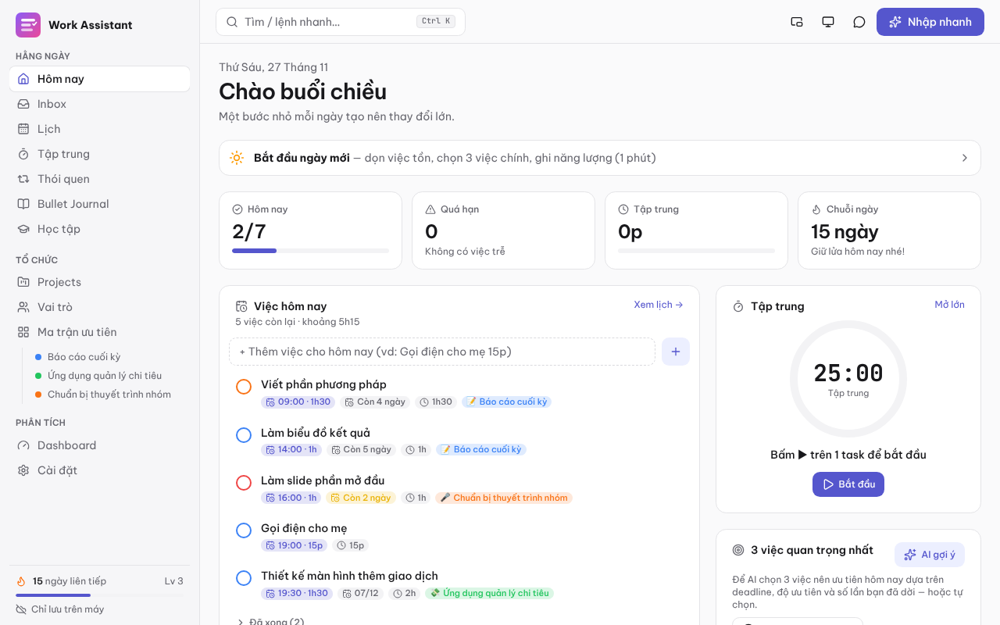
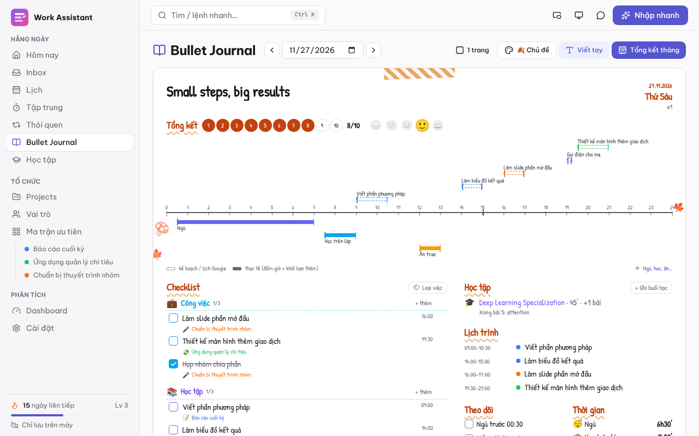
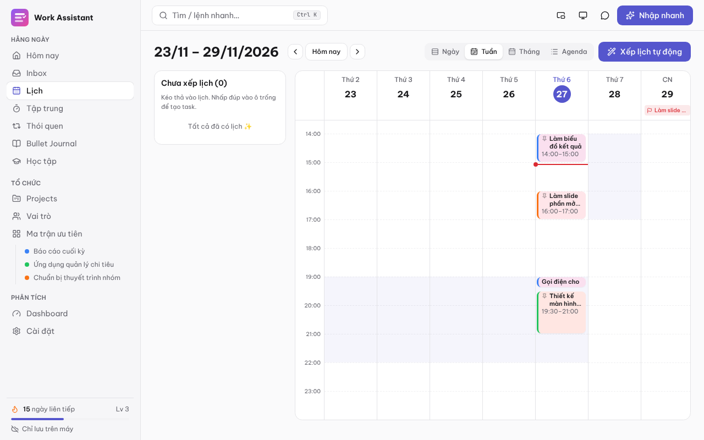
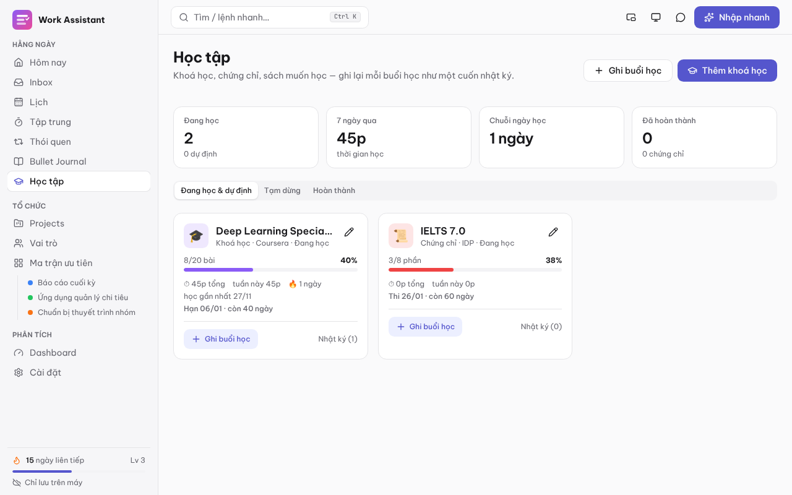
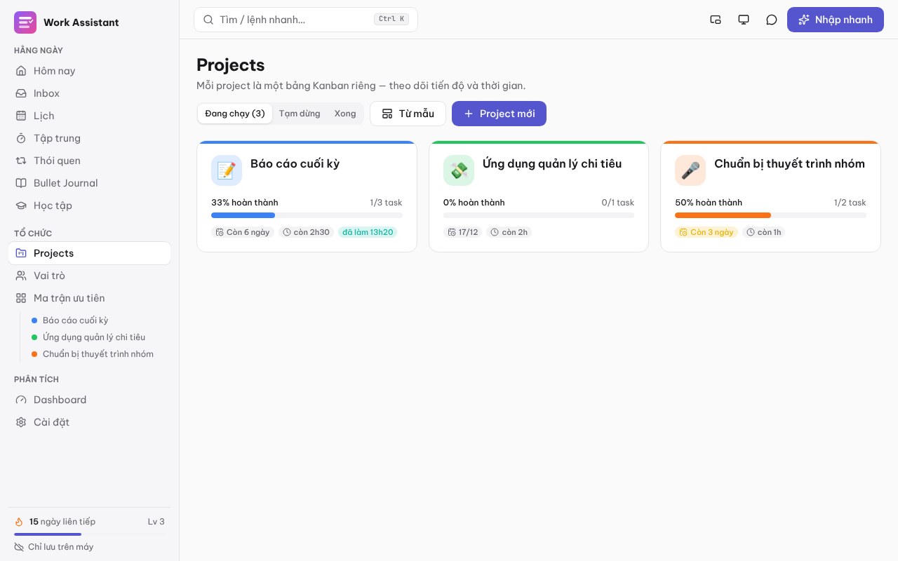
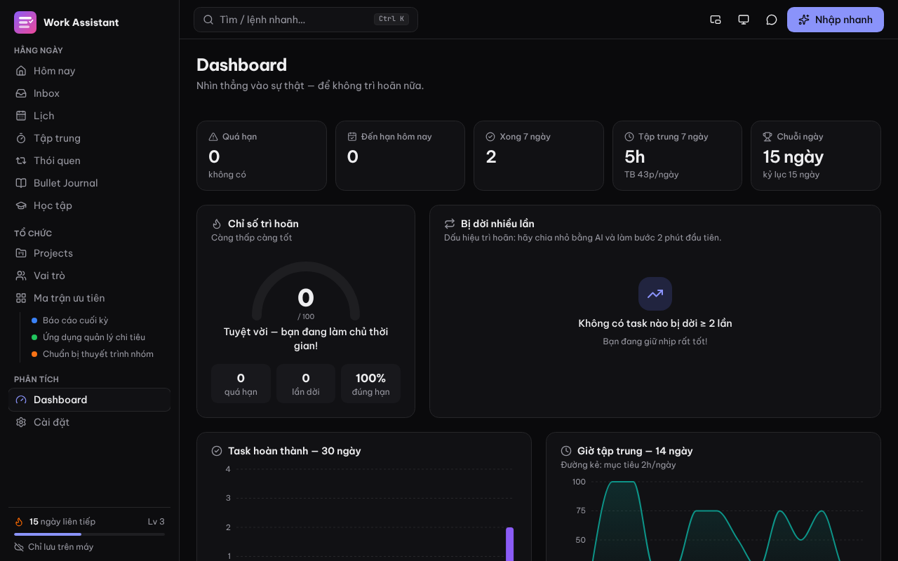

# My Work Assistant

> A personal productivity app that combines a task manager, an auto-scheduling calendar, a bullet journal, a habit tracker and a learning log, with AI that turns rough notes into planned tasks.

[](https://github.com/thuyduong115/my-work-assistant/actions/workflows/deploy.yml)


**Live app:** https://thuyduong115.github.io/my-work-assistant/

It runs entirely in the browser as an installable PWA that works offline. You can optionally sync across devices with Supabase and connect Google Calendar. The interface is in Vietnamese.



---

## Table of contents

- [Features](#features)
- [Screenshots](#screenshots)
- [Getting started (as a user)](#getting-started-as-a-user)
- [Installation (for development)](#installation-for-development)
- [Configuration](#configuration)
- [Deployment](#deployment)
- [Project structure](#project-structure)
- [Data and privacy](#data-and-privacy)
- [Keyboard shortcuts](#keyboard-shortcuts)
- [Tech stack](#tech-stack)

## Features

### Plan
| | |
|---|---|
| **AI quick capture** | Write naturally (*"Prepare thesis defense before 20/12, slides, chapter 4 report…"*) and AI splits it into tasks with deadlines, estimates, priorities and a project. You can also paste an email or chat message and only the to-dos are extracted. An offline parser is used when no AI key is set. |
| **Auto-scheduling** | Tasks are placed into your free hours before their deadlines, split into focus blocks and kept clear of Google Calendar events. The app warns you when time runs short and learns how much longer you usually take than your estimate. |
| **Today** | Today's plan by time, overdue and missed items, deadlines for the next 7 days, a morning/evening ritual and AI "top 3". |
| **Calendar** | Day, week, month and agenda views. Drag, drop and resize blocks; double-click to create a task. |
| **Projects and roles** | A Kanban board, list, timeline and notes per project; 7 project templates; time balance across the roles you hold. |
| **Eisenhower matrix** | Drag tasks between the urgent and important quadrants. |

### Reflect
| | |
|---|---|
| **Bullet journal** | Daily pages with a 0–24h Gantt-style timeline (planned vs. actual), a checklist grouped by category with checkboxes, schedule, habits, time totals and notes. Shows a two-page spread on wide screens. Each month can have its own decoration theme (autumn, Christmas, Tết, cherry blossom…). |
| **Monthly review** | A "year in pixels" calendar, habit grid, study time per course, time per project, wins and an AI-written summary. Printable to PDF. |
| **Dashboard** | Procrastination score, tasks postponed repeatedly, completion and focus charts, estimate vs. actual, best focus hours, a yearly heatmap and badges. |

### Grow
| | |
|---|---|
| **Habits** | Check, count, amount (e.g. 2 L of water in 250 ml taps), duration or "at most" goals. A "next habits" queue lets you build habits one at a time. |
| **Learning tracker** | Courses, certificates, books and skills with progress in units, target and exam dates, plus a daily study log that also shows in the bullet journal. |
| **Focus** | Pomodoro or stopwatch linked to a task, background noise, an always-on-top mini timer (Picture-in-Picture), a "2-minute start" for tasks you keep postponing, and a warning when you leave the tab mid-focus. |
| **AI assistant** | A chat that knows your tasks, plan and habits and can add the tasks it suggests. |

### Integrations
| | |
|---|---|
| **Supabase sync** | Offline-first sync between laptop and phone in near real time; the newer copy of a record wins. |
| **Google Calendar** | Imports your events and avoids them when scheduling. Writes **finished** work back as `Project: Task` at the time you actually worked on it, turning the calendar into a log. See [docs/GOOGLE_CALENDAR.md](docs/GOOGLE_CALENDAR.md). |
| **Reminders** | Notifications before planned blocks, a deadline digest and ritual prompts while the app is open. |
| **Backup** | JSON export and import, a trash bin and a sync health check. |

## Screenshots

| Bullet journal | Calendar |
|---|---|
|  |  |
| **Learning tracker** | **Projects** |
|  |  |
| **Dashboard (dark mode)** | |
|  | |

## Getting started (as a user)

No installation is needed. Open the [live app](https://thuyduong115.github.io/my-work-assistant/).

1. **Install it** (optional): in Chrome or Edge, click the **⊕ Install** icon in the address bar. On iPhone, use Safari → Share → *Add to Home Screen*. On Android, use Chrome menu → *Install app*.
2. **Add a free AI key**: go to *Cài đặt → AI* and paste a [Gemini API key](https://aistudio.google.com/apikey) (recommended), a [Groq](https://console.groq.com/keys) key or an [OpenRouter](https://openrouter.ai/keys) key. Without a key, the offline parser still works.
3. **Set your free hours**: go to *Cài đặt → Giờ làm việc* so auto-scheduling knows when you can work.
4. **Sync across devices** (optional): go to *Cài đặt → Đồng bộ Supabase*, then sign up or sign in. See [docs/SUPABASE.md](docs/SUPABASE.md).
5. **Connect Google Calendar** (optional): go to *Cài đặt → Google Calendar*. See [docs/GOOGLE_CALENDAR.md](docs/GOOGLE_CALENDAR.md).

Everything is stored in your browser first, so the app keeps working offline.

## Installation (for development)

**Requirements:** Node.js 22+ and npm.

```bash
git clone https://github.com/thuyduong115/my-work-assistant.git
cd my-work-assistant
npm install
npm run dev        # http://localhost:5173/my-work-assistant/
```

| Script | What it does |
|---|---|
| `npm run dev` | Start the dev server |
| `npm run build` | Type-check and build into `dist/` |
| `npm run preview` | Serve the production build locally |
| `npm run typecheck` | TypeScript only |

The icon set (Phosphor) is generated into `public/icons/ph.json` automatically before `dev` and `build`.

## Configuration

Everything can be set from the app's **Settings** page. To pre-fill it for every device, set these at build time:

| Variable | Purpose |
|---|---|
| `VITE_SUPABASE_URL` | Supabase project URL |
| `VITE_SUPABASE_ANON_KEY` | Supabase publishable (anon) key |
| `VITE_GOOGLE_CLIENT_ID` | Google OAuth client ID (Web application) |

- **Locally:** put them in a `.env.local` file.
- **On GitHub:** add them under *Settings → Secrets and variables → Actions → **Variables***. The deploy workflow passes them to the build, and the *Keep Supabase awake* workflow uses them to ping the project every 3 days, so the free plan doesn't pause it.

These values are public by design (they ship to every browser). Never put a Supabase **service-role** key or a Google **client secret** in them.

**Supabase setup:** create a free project, run the SQL shown in *Settings → Đồng bộ Supabase → Hướng dẫn cài đặt* (one `items` table with row-level security), then copy the URL and publishable key. Details: [docs/SUPABASE.md](docs/SUPABASE.md).

## Deployment

The site is deployed to **GitHub Pages** with GitHub Actions ([`.github/workflows/deploy.yml`](.github/workflows/deploy.yml)):

1. In the repository, go to *Settings → Pages → Source* and choose **GitHub Actions**.
2. Push to `main`. The workflow builds the app and publishes `dist/`.

To host it under a different path or repository name, change `base` in [`vite.config.ts`](vite.config.ts).

## Project structure

```
src/
├── pages/        # Today, Calendar, Projects, Habits, Journal, Learning, Dashboard, Settings…
├── components/   # UI kit (Radix-based), task editor, timer, dialogs, journal themes
├── lib/          # scheduler, stats, habits, bullet-journal and learning logic, reminders
├── db/           # Dexie (IndexedDB) schema, hooks and actions
├── ai/           # Gemini / Groq / OpenRouter clients and the offline parser
├── sync/         # Supabase sync engine and SQL schema
├── gcal/         # Google Calendar import and work log
└── stores/       # Zustand stores (settings, UI, timer)
docs/             # setup guides, plan and screenshots
```

## Data and privacy

- **Local first:** data lives in your browser (IndexedDB) and works without an account.
- **Sync:** when you sign in, records are copied to *your* Supabase project. Row-level security limits every row to its owner.
- **AI:** your AI key is stored only in your browser. Task text is sent only to the AI provider you choose, and only when you use an AI feature.
- **Google:** the app talks to Google directly from your browser using a short-lived token. No server stores it.

## Keyboard shortcuts

| Keys | Action |
|---|---|
| `Ctrl/⌘ + K` | Command palette and task search |
| `N` | AI quick capture |
| `A` | New task |
| `T` · `I` · `C` · `F` · `H` · `J` · `L` | Today · Inbox · Calendar · Focus · Habits · Journal · Learning |
| `P` · `R` · `M` · `D` | Projects · Roles · Matrix · Dashboard |
| `Ctrl + Enter` | Save in a form |

## Tech stack

React 19 · TypeScript · Vite · Tailwind CSS v4 · Radix UI (shadcn-style components) · Dexie (IndexedDB) · Zustand · dnd-kit · Recharts · cmdk · date-fns · Supabase · Google Identity Services · vite-plugin-pwa (Workbox)

---

The original product plan (in Vietnamese) is in [docs/PLAN.md](docs/PLAN.md).
